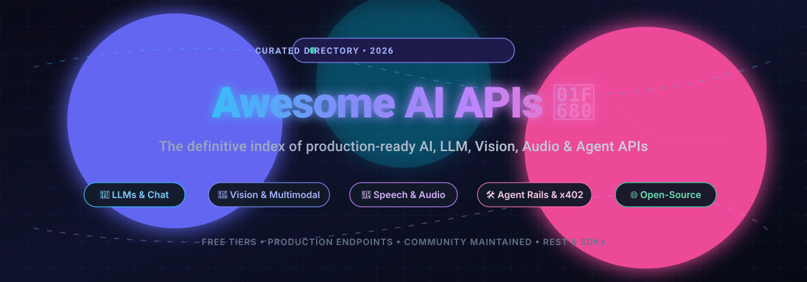
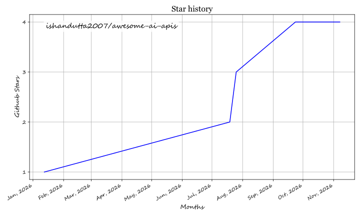

<!--
description: A collaborative, production-grade directory of public AI APIs & open-source AI frameworks covering LLMs, image generation, speech, vision, embeddings, vector databases, and autonomous agent rails (x402/MCP).
keywords: AI APIs, machine learning APIs, artificial intelligence, LLM APIs, image generation APIs, speech APIs, vision APIs, open-source AI, free AI APIs, developer tools, AI integrations, awesome list, vLLM, Ollama, OpenAI, Anthropic Claude, Gemini API, x402
-->
# Awesome AI APIs 🚀

<p align="center">
  
</p>

<p align="center">
  <a href="https://github.com/ishandutta2007/Awesome-Awesome-Awesome"></a><a href="https://discord.gg/jc4xtF58Ve"></a>
  <a href="https://github.com/ishandutta2007/awesome-ai-apis/stars/0"></a>
  <a href="https://github.com/ishandutta2007/awesome-ai-apis/network/members"></a>
  <a href="https://github.com/ishandutta2007/awesome-ai-apis/graphs/contributors"></a>
  <a href="https://github.com/ishandutta2007/awesome-ai-apis/issues"></a>
  <a href="https://github.com/ishandutta2007/awesome-ai-apis/pulls"></a>
  <a href="https://github.com/ishandutta2007/awesome-ai-apis/commits/main"></a>
  <a href="LICENSE"></a>
  <a href="https://github.com/ishandutta2007/Awesome-Awesome-Awesome"></a>
  <a href="https://github.com/ishandutta2007"></a>
</p>

---

A collaborative, community-maintained list of **publicly available AI APIs** and **self-hostable open-source inference servers** for developers, researchers, and enthusiasts. Manually curated to prioritize production reliability, explicit pricing transparency, generous free tiers, and autonomous agent interoperability.

Inspired by [public-apis/public-apis](https://github.com/public-apis/public-apis) and part of the [Awesome-Awesome-Awesome](https://github.com/ishandutta2007/Awesome-Awesome-Awesome) collection.

> 💡 **Tip**: APIs and pricing evolve rapidly. Check [issues](https://github.com/ishandutta2007/awesome-ai-apis/issues) for updates or submit a PR to keep entries fresh!

---

## Sector Overview & Market Dynamics 📊

The global AI and LLM API market is estimated at **$63B–$65B in 2025** and projected to exceed **$84B by 2026**, expanding at a rapid compound annual growth rate (CAGR) of over 31%. 

The market exhibits a distinct **dual dynamic**: it is **highly concentrated at the foundation model tier** where a handful of hyperscalers and frontier labs (OpenAI, Google, Anthropic, Meta) capture over 70% of enterprise API expenditures, while remaining **moderately to highly fragmented across mid-layer inference engines, open-weight hosting, and autonomous agent tooling**, where rapid commoditization and open architectures drive intense developer competition.

---

## Table of Contents 📖

- [Sector Overview & Market Dynamics 📊](#sector-overview--market-dynamics-)
- [LLM & Chat APIs 💬](#llm--chat-apis-)
- [Image Generation 🖼️](#image-generation-️)
- [Speech & Audio 🎤](#speech--audio-)
- [Vision & Multimodal 👀](#vision--multimodal-)
- [Embeddings & Vector DB 🧠](#embeddings--vector-db-)
- [Agents & Tools 🛠️](#agents--tools-️)
- [Open-Source AI & Self-Hosted APIs 🌐](#open-source-ai--self-hosted-apis-)
- [Other AI ✨](#other-ai-)
- [How to Contribute 🤝](#how-to-contribute-)
- [Support & Sponsorship ☕](#support--sponsorship-)
- [Star History 🌟](#star-history-)
- [License 📜](#license-)

---

## LLM & Chat APIs 💬

| API | Company Size (Valuation / ARR) | Description | Pricing | Free Tier / Trial Limits | Auth | HTTPS | CORS |
|-----|-------------------------------|-------------|---------|--------------------------|------|-------|------|
| [Google Gemini](https://ai.google.dev/) | Alphabet (~$2.2T+ Market Cap) | Gemini 2.0 Flash/Pro for multimodal, low-latency apps. | Starting at $0.10/1M input, $0.40/1M output tokens (Gemini 2.0 Flash pay-as-you-go) | Free forever on Google AI Studio: 15 RPM, 1M TPM, 1,500 RPD (Gemini Flash models, prompts used for training) | `apiKey` | Yes | Yes |
| [Meta Llama](https://llama.meta.com/) | Meta (~$1.5T+ Market Cap) | Llama 4 Scout/Maverick via partners (e.g., Groq, Replicate). Open-source weights. | Free self-hosted open weights; partner hosted starting at $0.05/1M tokens | Open weights free for download; hosted free tiers vary by provider (e.g., Groq 30 RPM free) | Varies | Yes | Yes |
| [Anthropic Claude](https://docs.anthropic.com/en/api/getting-started) | ~$1T+ Valuation (~$17B ARR scale) | Claude 3.5 Sonnet, Opus for advanced reasoning & coding. | Starting at $0.25/1M input, $1.25/1M output tokens (Claude 3.5 Haiku) | $5 one-time promotional sign-up credits (valid for initial testing); no recurring free tier | `apiKey` | Yes | Yes |
| [OpenAI](https://platform.openai.com/docs/api-reference) | ~$850B+ Valuation (~$50B+ ARR) | GPT-4o, o1, GPT-5 series for text, reasoning, vision, voice. | Starting at $0.15/1M input, $0.60/1M output tokens (GPT-4o mini) | Pay-as-you-go ($5 min deposit); no recurring free tier. ChatGPT Pro/Business get $100–$500/mo API credits | `apiKey` | Yes | Yes |
| [xAI Grok](https://docs.x.ai/) | ~$250B Valuation (~$3.5B ARR) | Grok-4 for real-time reasoning, math, vision. Integrated with X data. | Starting at $2.00/1M input, $10.00/1M output tokens (Grok-2) | Up to $150/mo free credits via opt-in data-sharing program (after $5 initial spend; regional restrictions apply) | `apiKey` | Yes | Yes |
| [Mistral AI](https://docs.mistral.ai/api/) | ~$25B Valuation (~$400M ARR) | Mistral Large 2, Mixtral for efficient multilingual tasks. Open weights. | Starting at $0.10/1M input, $0.10/1M output tokens (Ministral 3B) / $0.15 in, $0.60 out (Mistral Small) | Free experimental mode on La Plateforme: 1 req/sec, ~30 RPM cap across available models | `apiKey` | Yes | Yes |
| [Cohere](https://docs.cohere.com/docs) | ~$22B Valuation (~$240M ARR) | Command R+ for RAG, enterprise chat. Free prototyping. | Starting at $0.15/1M input, $0.60/1M output tokens (Command R) | Free forever Trial Key for non-commercial evaluation: 1,000 calls/month, 20 RPM on Chat | `apiKey` | Yes | Yes |
| [Together AI](https://docs.together.ai/docs) | ~$8.3B Valuation (~$1B ARR scale) | 300+ open models (Qwen, DeepSeek). Serverless inference. | Starting at $0.15/1M input, $0.60/1M output tokens (Llama/Flash models) | $5 min reload ($15 initial credit purchase); startup accelerator provides $15k–$50k grants on approval | `apiKey` | Yes | Yes |
| [Groq](https://console.groq.com/docs/api-reference) | ~$3.5B Valuation (~$500M ARR scale) | Ultra-fast LPU inference for Llama, Mixtral, Gemma. | Starting at $0.05/1M input, $0.08/1M output tokens (Llama 3.1 8B) | Free forever plan: 30 RPM, up to 30,000 TPM, and 100,000–500,000 TPD (model-dependent) | `apiKey` | Yes | Yes |
| [DeepInfra](https://deepinfra.com/docs) | ~$50M–$100M Est. Valuation | Affordable hosting for Llama, Mistral, Qwen. Pay-per-use. | Starting at $0.03/1M input, $0.05/1M output tokens (Llama 3.1 8B) | $1.80 free trial credits on new account sign-up and verification; no monthly subscription | `apiKey` | Yes | Yes |
| [CoderPlan](https://coderplan.ai) | Bootstrapped / Seed Scale | Unified LLM API gateway for Claude, GPT, Gemini, DeepSeek, Grok. OpenAI-compatible. Pay-per-use with Alipay/WeChat. | Non-expiring prepaid packages starting at $7.14 for $50 credit balance | One-time signup promotional test credits for initial evaluation; no recurring free tier | `apiKey` | Yes | Yes |
| [WebWright](https://webwright.ai) | OpenAI-compatible API serving the Wren R1 model; input $0.40 and output $1.60 per 1M tokens. | `apiKey` | Yes | Unknown |

**Back to Index** 👆

---

## Image Generation 🖼️

| API | Company Size (Valuation / ARR) | Description | Pricing | Free Tier / Trial Limits | Auth | HTTPS | CORS |
|-----|-------------------------------|-------------|---------|--------------------------|------|-------|------|
| [OpenAI DALL-E](https://platform.openai.com/docs/api-reference/images) | ~$850B+ Valuation (~$50B+ ARR) | DALL-E 3 & GPT Image models for high-quality visual generation. | Starting at $0.040/image (standard 1024×1024) / $0.080/image (HD quality) | Pay-as-you-go ($5 min deposit); no recurring free tier credits | `apiKey` | Yes | Yes |
| [Replicate](https://replicate.com/docs) | ~$3B Valuation (~$100M ARR) | Run Flux, SDXL, custom models via cloud GPUs. | Hardware compute starting at $0.00025/sec (CPU) / $0.001525/sec (GPU), or ~$0.003–$0.04/image (Flux) | Limited free trial predictions in web playground/demo mode (throttled at 1 req/sec, 6 RPM max); no recurring free tier | `apiKey` | Yes | Yes |
| [Stability AI](https://platform.stability.ai/docs/api-reference) | ~$1B Valuation | Stable Diffusion 3, Flux for text-to-image and inpainting. | Starting at $0.03/image (3 credits) for SD 3.5 Large / $0.02 for edits | 25 free credits ($0.25 value, ~8–12 standard generations) upon signup; no recurring monthly quota | `apiKey` | Yes | Yes |

**Back to Index** 👆

---

## Speech & Audio 🎤

| API | Company Size (Valuation / ARR) | Description | Pricing | Free Tier / Trial Limits | Auth | HTTPS | CORS |
|-----|-------------------------------|-------------|---------|--------------------------|------|-------|------|
| [OpenAI TTS/Whisper](https://platform.openai.com/docs/api-reference/audio) | ~$850B+ Valuation (~$50B+ ARR) | Text-to-speech, speech-to-text (Whisper). | Whisper STT at $0.006/minute ($0.36/hour); TTS starting at $0.015/1k characters | Pay-as-you-go ($5 min deposit); no recurring free tier | `apiKey` | Yes | Yes |
| [ElevenLabs](https://elevenlabs.io/docs/api-reference) | ~$22B Valuation (~$600M ARR) | Ultra-realistic voice cloning, text-to-speech, and audio isolation. | Paid starter plan at $5/month (first month $1) for 30,000 characters | Free forever tier: 10,000 characters/month (~10 mins audio), non-commercial attribution required, 3 custom voices | `apiKey` | Yes | Yes |
| [Deepgram](https://developers.deepgram.com/docs) | ~$250M Valuation (~$35M ARR) | High-accuracy real-time STT with diarization & TTS. | Pre-recorded STT starting at $0.0043/min; streaming at $0.0048/min; TTS at $0.015/1k characters | $200 free trial credits upon sign-up (no credit card required, up to 150 concurrent streams) | `apiKey` | Yes | Yes |

**Back to Index** 👆

---

## Vision & Multimodal 👀

| API | Company Size (Valuation / ARR) | Description | Pricing | Free Tier / Trial Limits | Auth | HTTPS | CORS |
|-----|-------------------------------|-------------|---------|--------------------------|------|-------|------|
| [Google Gemini Vision](https://ai.google.dev/gemini-api/docs/vision) | Alphabet (~$2.2T+ Market Cap) | Multimodal reasoning across high-res images and video sequences. | Starting at $0.10/1M input tokens (Gemini 2.0 Flash pay-as-you-go) | Free forever on Google AI Studio: 15 RPM, 1M TPM, 1,500 RPD (Flash multimodal tier) | `apiKey` | Yes | Yes |
| [OpenAI Vision](https://platform.openai.com/docs/vision) | ~$850B+ Valuation (~$50B+ ARR) | GPT-4o multimodal image analysis, OCR, visual reasoning. | Starting at $0.15/1M input tokens + $0.001275/standard low-res tile (GPT-4o mini) | Pay-as-you-go ($5 min deposit); no recurring free tier | `apiKey` | Yes | Yes |
| [Hugging Face Inference](https://huggingface.co/docs/inference-endpoints) | ~$4.5B Valuation (~$100M ARR) | Llava, Bakllava, and open vision models on shared/dedicated infra. | Dedicated endpoints start at $0.06/hour (CPU) to $0.60+/hour (GPU); PRO plan $9/month | Serverless inference free tier provides ~$0.10/mo in inference credits (rate-limited, hard stop when exhausted) | `apiKey` | Yes | Unknown |

**Back to Index** 👆

---

## Embeddings & Vector DB 🧠

| API | Company Size (Valuation / ARR) | Description | Pricing | Free Tier / Trial Limits | Auth | HTTPS | CORS |
|-----|-------------------------------|-------------|---------|--------------------------|------|-------|------|
| [OpenAI Embeddings](https://platform.openai.com/docs/guides/embeddings) | ~$850B+ Valuation (~$50B+ ARR) | Text-embedding-3-small and text-embedding-3-large models. | Starting at $0.02/1M input tokens (text-embedding-3-small) / $0.13/1M (large) | Pay-as-you-go ($5 min deposit); no recurring free tier | `apiKey` | Yes | Yes |
| [Cohere Embed](https://docs.cohere.com/docs/embed) | ~$22B Valuation (~$240M ARR) | High-performance multilingual embeddings & Rerank v3. | Starting at $0.10/1M tokens (Embed v3 English/Multilingual) | Free forever Trial Key: 1,000 API calls/month, 100 RPM for Embed endpoints (non-commercial) | `apiKey` | Yes | Yes |
| [Pinecone](https://docs.pinecone.io/docs/overview) | ~$750M Valuation (~$26M ARR) | Managed vector database with hybrid search & serverless architecture. | Paid Builder plan at $20/month; Standard pay-as-you-go from $0.0825/GB-month | Free forever Starter tier: 2 GB storage (~100k 1536-dim vectors), 1M read units/mo, 2M write units/mo, 5 indexes | `apiKey` | Yes | Yes |

**Back to Index** 👆

---

## Agents & Tools 🛠️

| API | Company Size (Valuation / ARR) | Description | Pricing | Free Tier / Trial Limits | Auth | HTTPS | CORS |
|-----|-------------------------------|-------------|---------|--------------------------|------|-------|------|
| [OpenAI Assistants](https://platform.openai.com/docs/assistants/overview) | ~$850B+ Valuation (~$50B+ ARR) | Custom autonomous agents with Code Interpreter and File Search. | Base token pricing (from $0.15/1M tokens) + Code Interpreter ($0.03/session) + File Search ($0.10/GB/day) | Pay-as-you-go ($5 min deposit); File Search includes 1 GB free storage per organization | `apiKey` | Yes | Yes |
| [Replicate Agents](https://replicate.com/docs/guides/agents) | ~$3B Valuation (~$100M ARR) | Deploy and run agentic workflow loops on serverless GPU containers. | Compute-based execution starting at $0.00025/sec CPU / $0.001525/sec GPU | Limited playground free runs (throttled at 1 req/sec, 6 RPM max) | `apiKey` | Yes | Yes |
| [Voidly Pay](https://voidly.ai/pay) | Early-Stage / Seed | x402 facilitator + agent payment rail with marketplace of 17 paid endpoints. USDC on Base. | Micropayments starting from $0.001 USDC per API call / stream | Testnet sandbox & faucet available with free mock USDC; protocol discovery free | `x402` (no apiKey) | Yes | Yes |
| [Superhighway](https://superhighway.walls.sh) | Early-Stage / Seed | Web search API for agents: search, news, images, scrape, research endpoints. MCP server `npx -y superhighway-mcp`. | Pay-per-call from $0.001–$0.005 USDC via x402 | Free forever API key tier with generous daily search queries; free discovery without account | `apiKey` / `x402` | Yes | Yes |
| [GoldBean](https://goldbean-api.xyz) | Early-Stage / Seed | 53 Chinese AI tools via x402 micropayments — 19 OCR types, ERNIE LLM, DeepSeek-R1, TTS, ASR, vision, NLP, translation. | Micropayments starting from $0.001/call (TTS) to $0.01/call (OCR) via Base USDC or Alipay | Free forever plan: 2,000 calls/day per IP (standard endpoints) and 50 calls/day (test tools), no signup needed | `x402` (no apiKey) | Yes | Yes |
| [Clarity](https://agent-tools.cloud/services/desktop-o99r0sf-tail935fba-ts-net-sub899) | Early-Stage / Seed | Base mainnet x402 research report ($2 USDC) + OpenAI-compatible chat ($0.001) APIs. External Base USDC payers only. | $0.001 USDC per chat call, $2.00 USDC per deep research report | Free `/.well-known/x402` and agent metadata discovery endpoints (0 USDC) | `x402` (no apiKey) | Yes | Unknown |

**Back to Index** 👆

---

## Open-Source AI & Self-Hosted APIs 🌐

For developers seeking full data sovereignty, zero egress costs, or on-premises deployment, these open-source frameworks expose production-grade, OpenAI-compatible REST and gRPC API endpoints:

| Project | License | Primary Focus | Hardware Requirements | Key Features |
|---------|---------|---------------|-----------------------|--------------|
| [vLLM](https://github.com/vllm-project/vllm) | Apache-2.0 | High-throughput LLM & VLM serving | NVIDIA/AMD GPUs (CUDA/ROCm) | PagedAttention, continuous batching, chunked prefill, speculative decoding, drop-in OpenAI-compatible server |
| [Ollama](https://github.com/ollama/ollama) | MIT | Local LLM runner & lightweight API | CPU, Apple Silicon, NVIDIA/AMD GPUs | Single-command model pulling (Llama 3, DeepSeek, Mistral), local REST API, Modelfile customization |
| [TGI (Text Generation Inference)](https://github.com/huggingface/text-generation-inference) | Apache-2.0 | Production-scale Hugging Face model serving | NVIDIA/AMD GPUs, Gaudi | Tensor parallelism, token streaming, watermarking, optimized FlashAttention-2 kernels |
| [LocalAI](https://github.com/mudler/LocalAI) | MIT | Drop-in OpenAI API replacement | CPU & Consumer GPUs | Text, audio (Whisper), image generation (SD), and embeddings without requiring dedicated data center GPUs |
| [SGLang](https://github.com/sgl-project/sglang) | Apache-2.0 | Ultra-fast structured LLM & agent inference | NVIDIA GPUs | RadixAttention (prefix caching across calls), structured JSON decoding, high-throughput multi-agent execution |
| [FastChat](https://github.com/lm-sys/FastChat) | Apache-2.0 | Multi-model serving and evaluation platform | Multi-GPU / CPU | Powers the LMSYS Chatbot Arena; distributed serving with OpenAI-compatible REST endpoints |
| [Qdrant](https://github.com/qdrant/qdrant) | Apache-2.0 | Open-source vector database & search engine | CPU, RAM, optional disk-backed storage | Rust-powered vector indexing, payload-based filtering, gRPC/REST APIs, distributed clustering |
| [Chroma](https://github.com/chroma-core/chroma) | Apache-2.0 | AI-native open-source embedding database | Lightweight CPU / In-memory | Python/JS native client, document chunking, full-text & vector hybrid search, built-in embedding adapters |

**Back to Index** 👆

---

## Other AI ✨

| API | Company Size (Valuation / ARR) | Description | Pricing | Free Tier / Trial Limits | Auth | HTTPS | CORS |
|-----|-------------------------------|-------------|---------|--------------------------|------|-------|------|
| [Hugging Face Hub](https://huggingface.co/docs/hub/en/api) | ~$4.5B Valuation (~$100M ARR) | 1M+ open models and datasets for NLP, audio, vision, and tabular data. | Free community hosting; PRO user tier at $9/month | Free forever: 1,000 API requests per 5-min window, 5,000 resolver/download requests per 5-min window | `apiKey` (opt) | Yes | Yes |

**Back to Index** 👆

---

## How to Contribute 🤝

Please read [CONTRIBUTING.md](CONTRIBUTING.md) for full submission guidelines.

1. **Fork the Repository** and clone your fork locally.
2. **Add an API Entry**: Append your API to the appropriate category table adhering to the schema:
   ```markdown
   | [Name](link) | Company Size | Description | Pricing | Free Tier / Trial Limits | Auth | HTTPS | CORS |
   ```
3. **Verify Reliability**: Ensure the API is active, has public documentation, and includes transparent pricing/free tier data.
4. **Submit a Pull Request**: Provide a clean description in your PR. No self-promotion spam.

---

## Support & Sponsorship ☕

Thank you for exploring and utilizing the **Awesome AI APIs** directory! If this repository helped you discover the right API for your app, saved you hours of pricing research, or powered your autonomous agent workflows, please consider supporting the project:

- ⭐ **Star this repository** to help others discover it across GitHub.
- 🍴 **Fork and contribute** new production endpoints or pricing updates.
- 📢 **Share with fellow developers** on X, Discord, Reddit, and LinkedIn.
- ☕ **Buy a coffee / Sponsor the project**: Support ongoing maintenance, automated health checks, and curation on our [GitHub Sponsors Dashboard](https://github.com/sponsors/ishandutta2007).

<p align="center">
  <a href="https://github.com/sponsors/ishandutta2007">
    
  </a>
</p>

---

## Star History 🌟

[](https://star-history.dera.page/#ishandutta2007/awesome-ai-apis&type=date&legend=top-left)

---

## License 📜

This repository is distributed under the [MIT License](LICENSE).

---

*Built with ❤️ by the global AI community. Started Jan 12, 2026.*

## ⭐ Star History

<a href="https://star-history.com/#ishandutta2007/awesome-ai-apis&Timeline" align="center">
  <picture>
    <source media="(prefers-color-scheme: dark)" srcset="assets/ishandutta2007_awesome-ai-apis_growth.svg">
    
  </picture>
</a>
